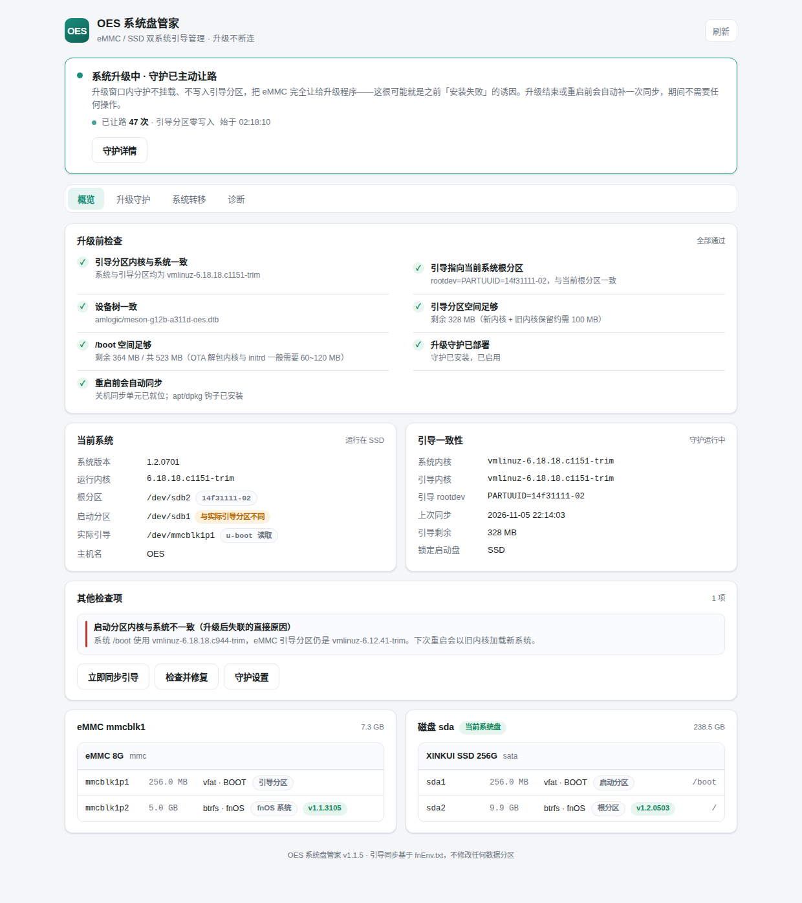

# OES 系统盘管家（oesboot）


[](https://github.com/ranlove99)

> **作者 / 维护者：[ranlove99](https://github.com/ranlove99)** · 仓库：[github.com/ranlove99/oes-boot-mgr](https://github.com/ranlove99/oes-boot-mgr)

给 **OES / OES Plus**（Amlogic 引导、eMMC + SSD）用的 fnOS 应用。把系统迁到 SSD 之后，**系统升级不再需要「切回 eMMC 再升一次」**。

它做三件事：**诊断**引导一致性、**守护**升级前后的内核同步、以及在需要时**迁移 / 切换 / 修正**启动盘。全部本地运行，不联网、不回传数据。

> [!WARNING]
> 本应用会写引导分区、`/etc/fstab` 和包管理器钩子，属于**高风险系统工具**。
> 操作前请备份数据、准备一个可启动的 U 盘。详见 [风险声明](#9-风险声明)。



---

## 目录

1. [它解决什么问题](#1-它解决什么问题)
2. [功能](#2-功能)
3. [安装](#3-安装)
4. [使用](#4-使用)
5. [项目结构](#5-项目结构)
6. [命令行](#6-命令行)
7. [开发](#7-开发)
8. [常见问题](#8-常见问题)
9. [风险声明](#9-风险声明)
10. [上传到 GitHub](#10-上传到-github)
11. [许可证](#11-许可证)

---

## 1. 它解决什么问题

OES 的 u-boot 行为是写死的：**只从 eMMC 的引导分区 `mmcblk1p1` 读 `fnEnv.txt`、内核、initrd 和 dtb**；而 `fnEnv.txt` 里的 `rootdev` 决定根文件系统挂在哪块盘。

```
u-boot ──► eMMC p1 (fnEnv.txt + 内核) ──► rootdev=PARTUUID=xxxx-02 ──► SSD p2 (根文件系统)
```

把系统迁到 SSD 后，`/boot` 通常也跟着挂在 SSD 的 `sdb1`。于是 OTA 升级时出现分裂：

| 位置 | 升级后 | 谁在读 |
| --- | --- | --- |
| `/boot`（SSD `sdb1`） | 新内核 `c1191` | fnOS 更新器 |
| eMMC 引导分区 `p1` | 旧内核 `c1151` | **u-boot，重启时** |

结果就是「**新用户态 + 旧内核**」：轻则新特性用不上，重则模块不匹配、数据卷挂不上。传统土办法是「升 SSD → 失联 → U 盘启动 → 切回 eMMC 升一次 → 再切回 SSD」。

本应用把这套流程自动化：**OTA 写进 `/boot` 的新内核，由守护搬到 eMMC 引导分区并更新那里的 `fnEnv.txt`**，赶在系统自动重启之前完成。

> **关于「修正引导布局」**：还有一个可选操作，把 `/boot` 直接改挂到 eMMC p1，从根上消除不一致。
> `rootdev` 始终指向 SSD 根分区，**系统依旧从 SSD 启动**，`/usr`、`/var`、`/home` 全在 SSD 上。
> 只是内核文件改成放在 eMMC。因为它要改 fstab、有失联风险，所以是**可选项，不是升级前置条件**。

## 2. 功能

| 能力 | 说明 |
| --- | --- |
| 引导一致性诊断 | 采集启动链、分区表、fstab / findmnt / systemd 挂载单元、fnEnv、各分区剩余空间，输出可导出的文本报告 |
| 升级就绪判定 | 9 项检查 + 一句话结论。`dpkg 配置损坏`、`引导内核不一致`、`根分区指错` 会红卡阻断；`布局不规范` 只是黄卡提醒 |
| 升级守护 | 五个触发点互为兜底（开机、关机前、10 分钟巡检、升级窗口内 20 秒、apt/dpkg 装包后），任一跑到即可 |
| 升级现场 | 失败时自动归档 17 段证据（含 apt/dpkg 日志原文、进程轨迹、守护自身状态），任何时刻可一键重新抓取并导出到存储空间 |
| 系统迁移 | 把系统克隆到另一块盘，事务性：写入引导是最后一步，中途失败仍从原盘启动 |
| 切换启动盘 | 在 eMMC / SSD 之间切换，优先使用首次同步前备份的 `fnEnv` |
| 引导布局修正 | 可选的 hybrid 布局，带预检、`mount -a --fake` 语法校验、落地校验与一键回滚 |
| dpkg 配置自愈 | 启动时检测并修复早期版本写坏的钩子，首页提供「修复 dpkg 配置」按钮 |

## 3. 安装

### 从 Release 安装（推荐）

1. 到 [Releases](https://github.com/ranlove99/oes-boot-mgr/releases) 下载 `oesboot_<版本>_arm.fpk` 与同名的 `.sha256`；
2. （可选）校验：`sha256sum -c oesboot_1.1.20.sha256`；
3. fnOS **应用中心 → 手动安装** → 选择 fpk；
4. 安装向导保持「启用升级守护」打开（默认开启）。

命令行安装：

```sh
appcenter-cli install-fpk oesboot_1.1.20_arm.fpk
```

### 从源码构建

需要 bash、python3 和联网（首次会下载 `fnpack`）：

```bash
git clone https://github.com/ranlove99/oes-boot-mgr.git
cd oes-boot-mgr
make verify                 # 建议先跑一遍
make build                  # 产物：dist/oesboot_1.1.20_arm.fpk + .sha256
```

`dist/` 不入库（见 `.gitignore`），发布时作为 Release 附件上传。

### 系统要求

| 项 | 要求 |
| --- | --- |
| 机型 | OES / OES Plus（Amlogic，`/boot/fnEnv.txt` 引导结构） |
| 系统 | fnOS ≥ 1.1.3100 |
| 架构 | `arm` / aarch64 |
| 运行时 | python3（fnOS 自带 python312 亦可）；**无第三方 Python 依赖** |
| 系统命令 | `lsblk` `blkid` `findmnt` `flock` `rsync` `journalctl` |

> 守护本体是**纯 shell**，即使 Python 环境异常，引导保护依然生效。

## 4. 使用

### 第一次打开

概览页第一张卡是「升级前检查」，9 项逐条给结论：

| 级别 | 检查项 |
| --- | --- |
| 阻断（error） | `dpkg 配置可正常解析`、`引导分区内核与系统一致`、`引导指向当前系统根分区` |
| 提醒（warn） | `引导布局符合 OTA 要求`、`设备树一致`、`引导分区 / /boot 空间`、`守护已部署`、`重启前会自动同步` |

有阻断项时点「一键修复」（重装守护 + 同步一次 + 复检）；dpkg 配置坏了则点「修复 dpkg 配置」。

### 升级流程（重点）

**全程不需要 SSH，不需要手动同步，也不需要守着重启。**

1. 打开应用看首页结论：🟢 可以升级 → 直接下一步；🔴 先修复 → 按提示修好再看。
2. 点 **「启动升级守护」**，卡片变为「已就绪 · 等待升级」。**这时可以关掉网页**，守护是系统服务，不依赖界面。
3. 去 fnOS **系统设置 → 更新和还原** 点升级。
4. 升级完系统自动重启，直接回到 SSD 上的新系统。

原理：新内核写进 `/boot` 后，升级窗口内每 20 秒的监视会把它搬到 eMMC；即使恰好赶上重启，`shutdown.target` 里的关机同步也会在重启前再跑一次。

升级后验证：

```sh
uname -r                       # 应是新内核
oesboot status                 # 系统内核 / 引导内核两行一致
```

> 升级窗口只是「我开始等升级了」，**不代表正在升级**。让路只由「`/boot` 内核文件 120 秒内变过」或「`dpkg`/`apt` 正在跑」触发；界面会明确区分「已就绪 · 等待升级」和「升级中 · 已让路」。

### 升级现场（出问题时）

守护页有常驻的「升级现场」卡片，任何时刻点「抓取并导出」都会**重新采集一份**，同时写一份到 `/vol00` 下文件管理器可见的目录，卡片上直接显示完整路径。报告共 17 段，其中第十六段是 apt / dpkg 原文，第十七段是守护自身状态（为什么没自动同步）。

反馈问题时请附这份报告，详见 [问题反馈模板](.github/ISSUE_TEMPLATE/bug_report.md) 与 [排障手册](docs/TROUBLESHOOTING.md)。

### 修正引导布局（可选）

在首页布局警告处点「先修布局」。它会：备份 `fstab` 与两侧 `fnEnv` → 预检 eMMC 空间 → 复制内核 → 重写 eMMC `fnEnv`（`rootdev` 仍指 SSD）→ 改 `fstab` 把 `/boot` 指向 eMMC → `mount -a --fake` 语法校验 → 校验 `fnEnv` 指向的内核真实存在。任何一步失败自动还原。

**改完要重启才生效，且有失联风险。** 刚升级完、系统还在验证阶段时不要动；稳定跑几天、备好启动 U 盘再做。回滚：

```sh
sudo /usr/local/sbin/oes-boot-sync hybrid-rollback
```

## 5. 项目结构

```
oes-boot-mgr/
├── .github/
│   ├── workflows/ci.yml                  # Python 3.9/3.11/3.12 矩阵：语法 + 一致性 + 测试
│   └── ISSUE_TEMPLATE/bug_report.md      # 问题反馈模板
├── .editorconfig                         # 编码与缩进
├── .gitattributes                        # 强制 LF（脚本会被设备直接解释）
├── .gitignore
├── CHANGELOG.md                          # 25 个版本的更新日志
├── CONTRIBUTING.md
├── LICENSE                               # MIT + 高风险工具附加提示
├── Makefile                              # test / lint / check / build / preview
├── README.md
├── manifest                              # fnOS 应用元数据（版本 + changelog）
├── ICON.PNG  ICON_256.PNG                # 应用图标
├── app/
│   ├── assets/oes-boot-sync.sh           # 纯 shell 守护：唯一写引导分区的组件
│   ├── bin/oesboot                       # CLI 启动器（软链到 /usr/local/bin）
│   ├── cli.py                            # 命令行入口
│   ├── server.py                         # HTTP over Unix socket / 127.0.0.1
│   ├── core/
│   │   ├── __init__.py
│   │   ├── bootenv.py                    # fnEnv.txt 解析与重写
│   │   ├── guard.py                      # systemd 单元、钩子部署与自愈
│   │   ├── ops.py                        # 动作编排 / 异步任务
│   │   ├── sysinfo.py                    # 采集、9 项判定、诊断文本
│   │   └── util.py                       # 命令执行 / 文件读写
│   └── ui/
│       ├── index.html                    # 单文件前端（无构建步骤）
│       ├── config                        # 桌面入口配置
│       └── images/icon_64.png icon_256.png
├── cmd/                                  # 应用生命周期脚本（安装/升级/卸载/配置）
├── config/                               # privilege、resource
├── wizard/install                        # 安装向导
├── dev/fake-*.json                       # 无需设备即可预览界面的假数据
├── docs/
│   ├── README.md                         # 文档与截图索引
│   ├── ARCHITECTURE.md                   # 架构说明
│   ├── TROUBLESHOOTING.md                # 排障手册
│   └── preview-*.png                     # 界面截图
├── tests/test_core.py                    # 核心逻辑单元测试（不碰真实磁盘）
└── tools/
    ├── build.sh                          # 构建 fpk（fnpack + 结构/checksum 校验）
    └── check_consistency.py              # 版本/文件/换行符/危险钩子检查
```

`manifest`、`cmd/`、`config/`、`wizard/`、`app/`、`ICON*.PNG` 是 fnOS 打包约定，**不要改成 `src/` 布局**。详见 [CONTRIBUTING.md](CONTRIBUTING.md)。

## 6. 命令行

应用会安装 `oesboot` 到 `/usr/local/bin`：

```sh
oesboot status                    # 启动链状态（等价首页）
oesboot diagnose                  # 完整诊断报告，可导出贴给别人
oesboot upgrade                   # 升级就绪判定
oesboot watch start|stop          # 开启 / 结束升级监视
oesboot sync                      # 立即同步一次
oesboot repair                    # 检查并修复
oesboot switch ssd|emmc           # 切换启动盘（重启生效）
oesboot migrate /dev/sdb 64       # 迁移到 /dev/sdb，根分区 64G
oesboot guard install|status      # 部署 / 查看守护
oesboot policy lock=ssd auto_reboot=1
```

守护脚本也可直接调用（供排障与回滚）：

```sh
sudo /usr/local/sbin/oes-boot-sync sync --reason manual
sudo /usr/local/sbin/oes-boot-sync hybrid-rollback
```

日志：`/var/log/oesboot-guard.log`。

## 7. 开发

```bash
make help        # 列出全部命令
make verify      # = lint + check + test，提交前必跑
make test        # pytest
make preview     # 假数据起本地界面 http://127.0.0.1:8765
make build       # 构建 fpk
make clean       # 清理缓存
```

**不需要 OES 设备**。`make preview` 用 `dev/fake-*.json` 模拟四种状态（正常、等待升级、上次失败、布局警告），见 [dev/README.md](dev/README.md)。

`make check` 会把历史上踩过的坑固化成自动校验：三处（含本文件徽章）版本号一致、fpk 入口齐全、脚本可执行位、全部 LF、**代码中不得再出现引号内含 `>` `|` `&` 的 dpkg 钩子写法**、无密钥与本机路径。第 5 条来自 1.1.14 那次让整台机器包管理瘫痪的事故。

CI 在 Python 3.9 / 3.11 / 3.12 上跑同样的一套检查。贡献流程、安全红线与发布步骤见 [CONTRIBUTING.md](CONTRIBUTING.md)。

## 8. 常见问题

**Q：会影响数据盘吗？**
不会。守护只读写两个 FAT 引导分区；迁移会清空**你选择的目标盘**并反复确认。

**Q：eMMC 只有 8G，引导分区放得下吗？**
引导分区通常 200~500MB，内核 + initrd 约 70~100MB。空间不足时会自动清理未被引用的旧内核，但保留原始配置引用的那一份用于回退。检查项里也会提示剩余空间。

**Q：以后每次升级都要打开应用吗？**
不用。守护是系统服务，开机 / 关机 / 装内核时自动跑。应用只是查看和控制面板。但**升级前点一下「启动升级守护」是推荐的**，它把 20 秒快速监视打开，并把守护总开关置 1。

**Q：布局警告一直不消失，要不要修？**
不影响现在启动与升级。当前机制下，新内核由守护搬到 eMMC。只有当你频繁升级、或不想每次记得开守护时，才值得做「修正引导布局」。

**Q：卸载后会怎样？**
卸载会先做一次同步，再移除守护单元与 apt / dpkg 钩子，引导文件本身不改动。之后升级又会回到「需要手动切 eMMC」的状态。

**Q：为什么只有 `arm` 版？**
本项目读写的是 Amlogic / OES 的 `fnEnv.txt` 引导结构，x86 设备上没有这套东西。

**Q：升级 4 秒就失败 / 界面显示「同步完成」却没变化？**
见 [排障手册](docs/TROUBLESHOOTING.md)，这两个都是已修复的历史问题。

## 9. 风险声明

- 涉及分区表、`/etc/fstab` 与引导文件，属于**高风险操作**，请先备份重要数据并准备可启动的 U 盘。
- 迁移 / 切换 / 布局修正前，建议保存一份 `oesboot diagnose` 输出；备份在 `/var/lib/oesboot/backup/`。
- 本项目按「现状」提供（见 [LICENSE](LICENSE)），已在逻辑层做校验、备份与回滚，但不同批次 OES / OES Plus 的 u-boot 行为可能略有差异。**首次使用请先只做「同步」观察**，确认无误后再尝试迁移或布局修正。
- fnOS 为飞牛私有系统，本项目为第三方社区工具，与其官方无关。

## 10. 上传到 GitHub

本仓库已按可直接 push 的结构整理：根目录就是仓库根，`.gitignore` 排除构建产物，`.gitattributes` 强制 LF，首次提交已完成。

```bash
# 方式一：从导出的项目目录推送（已含 .git）
cd oes-boot-mgr
git remote add origin https://github.com/ranlove99/oes-boot-mgr.git
git push -u origin main

# 方式二：在 GitHub 网页新建空仓库（不要勾选初始化 README）后，用 SSH
git remote add origin git@github.com:ranlove99/oes-boot-mgr.git
git push -u origin main
```

若在别处重新克隆后推送，先确认 `git log --oneline -1` 与本地一致；仓库不含 `dist/`，发布包走 Releases：

```bash
make build                       # 生成 dist/oesboot_1.1.20_arm.fpk + .sha256
# 在 GitHub 建 tag v1.1.20 的 Release，附上传这两个文件
```

| 说明 | 值 |
| --- | --- |
| 仓库 | `https://github.com/ranlove99/oes-boot-mgr` |
| 默认分支 | `main` |
| 作者 / 维护者 | `ranlove99`（与 `manifest` 的 `maintainer`、`LICENSE` 一致） |
| 发布通道 | GitHub Releases，`dist/` 不入库 |

## 11. 许可证

[MIT](LICENSE) © 2026 [ranlove99](https://github.com/ranlove99) · 更新日志见 [CHANGELOG.md](CHANGELOG.md) · 架构与排障见 [docs/](docs/README.md)
