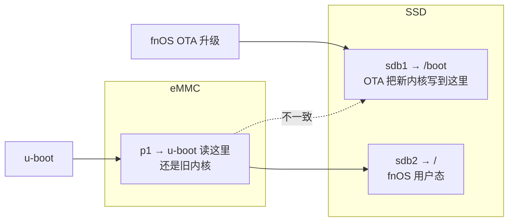
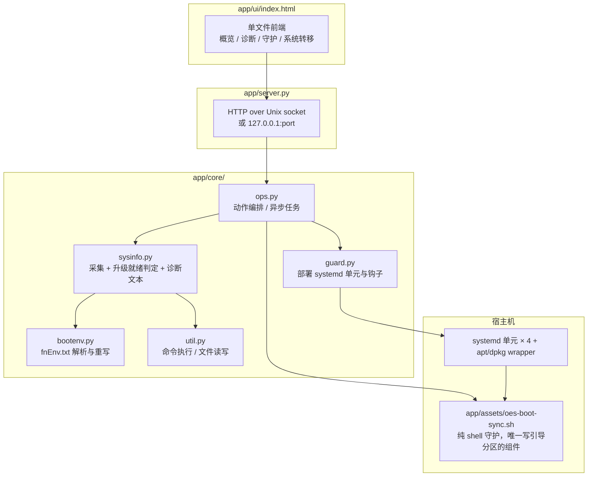

# 架构说明

本文解释 OES 的引导链、这个应用为什么要存在，以及代码各层如何配合。排障请看 [TROUBLESHOOTING.md](TROUBLESHOOTING.md)。

## 1. OES 的引导链

OES / OES Plus 使用 Amlogic SoC，u-boot 的行为是**写死**的：

`fnEnv.txt` 里最关键的两行：

| 键 | 含义 | 本例 |
| --- | --- | --- |
| `kernelfile` | 从 eMMC p1 加载哪个内核 | `vmlinuz-6.18.18.c1191-trim` |
| `rootdev` | 内核起来后把哪块分区挂成 `/` | `PARTUUID=14f31111-02`（SSD `sdb2`） |

**关键点：内核来自 eMMC，根文件系统来自 SSD。** 两者可以不是同一块盘。

## 2. 问题：把系统迁到 SSD 之后

迁移 SSD 时 `/boot` 通常跟着根分区走，挂在 SSD 的 `sdb1`。于是：

升级结束时系统是「**新用户态 + 旧内核**」，轻则新内核特性用不上，重则模块不匹配。传统解法是「升 SSD → 失联 → U 盘启动 → 切回 eMMC 升一次 → 再切回 SSD」。

本应用把这套流程自动化：**OTA 写进 `/boot` 的新内核，由守护搬到 eMMC p1，并更新那里的 `fnEnv.txt`。**

> 另有一个「修正引导布局」（hybrid）功能，把 `/boot` 直接改挂到 eMMC p1，从根上消除不一致。
> 根分区 `rootdev` 始终指向 SSD，**系统依旧从 SSD 启动**。改动有失联风险，因此只作为可选操作，
> 不作为升级前置条件。详见 [README §修正引导布局](../README.md)。

## 3. 组件分层

**设计原则：真正写引导分区的只有一个纯 shell 脚本。** 即使 Python 环境异常、Web 界面打不开，系统级的引导保护依然生效；Python 侧只负责采集状态、判定和编排。

| 文件 | 职责 |
| --- | --- |
| `app/assets/oes-boot-sync.sh` | 同步、让路、升级结算、现场取证、布局修正与回滚 |
| `app/core/sysinfo.py` | 采集启动链、磁盘、挂载、守护状态；生成 9 项升级检查与诊断报告 |
| `app/core/ops.py` | 把界面动作翻译成脚本调用，管理异步任务进度 |
| `app/core/guard.py` | 安装/卸载 systemd 单元、apt 与 dpkg 钩子；dpkg 配置自愈 |
| `app/core/bootenv.py` | `fnEnv.txt` 的解析与重写，保留原字段与引号风格 |
| `app/server.py` | 静态资源 + JSON API，Unix socket 由 fnOS 网关转发 |
| `app/cli.py` | 命令行入口 `oesboot` |

## 4. 五个触发点

互为兜底，任意一个跑到就够了。

| 触发 | 单元 / 钩子 | 周期 | 说明 |
| --- | --- | --- | --- |
| 开机 | `oesboot-sync.service` | 每次启动 | 顺带做一次修复检查 |
| 关机 / 重启前 | `oesboot-shutdown-sync.service` | 每次关机 | 兜底 `reboot -f`；`Before=umount.target`，确保 `/boot` 还挂着 |
| 定时巡检 | `oesboot-check.timer` | 每 10 分钟 | 无变化时不写盘、不刷日志 |
| 升级窗口内 | `oesboot-watch.timer` | 每 20 秒 | 仅在 `/run/oesboot-upgrade` 存在时工作 |
| 内核包装完 | apt / dpkg `Post-Invoke` → wrapper | 事件驱动 | 覆盖更新器直接 `dpkg -i` 的情况 |

**升级窗口**由用户点「启动升级守护」创建，标志在 `/run`（tmpfs，重启自动消失），最长 3 小时后视为残留失效。窗口本身只是「我开始等升级了」，**不代表正在升级**；让路只由两个真实信号触发：`/boot` 内核文件 120 秒内变过，或 `dpkg`/`apt` 正在运行。两者都不成立时照常巡检，而 `changed=0` 时脚本一个字节都不会写引导分区。

> dpkg 钩子必须走 `/usr/local/sbin/oesboot-dpkg-hook` 这个永远 `exit 0` 的 wrapper。
> 引号里不能出现 `>`、`|`、`&`——1.1.14 之前正是这么写的，导致整台机器包管理瘫痪。
> 这条约束由 `tools/check_consistency.py` 自动校验。

## 5. 一次同步做了什么

1. 取配置（`/etc/oesboot.conf`），判断触发来源；`ENABLED=0` 只拦自动触发，**手动同步一律执行**。
2. 互斥锁 `flock`：关机/开机最多等 25 秒，其它触发抢不到锁就跳过。
3. 定位 `/boot`、eMMC 引导分区，必要时以只读/读写方式挂载（已挂到 `/vol00` 则复用）。
4. **校验源**：内核文件大小、格式头、复制全程 `stat` 未变、模块目录（`/lib/modules` 与 `/usr/lib/modules` 任一有内容）已装齐。
5. 先写临时文件 → `sync` → 原子替换；全部成功后才重写 `fnEnv.txt`。失败保持原配置，旧系统仍能启动。
6. 记录 `.oesboot/last-sync`，输出 `RESULT=done` 或 `RESULT=skip:<原因>`。

脚本返回 0 **不代表同步成功**（让路、跳过、拒绝都是 0）。上层据 `RESULT=` 判定，避免界面出现「假成功」。

## 6. 状态与持久化位置

| 路径 | 介质 | 用途 |
| --- | --- | --- |
| `/run/oesboot-upgrade` | tmpfs | 升级窗口标志，重启即消失 |
| `/run/oes-boot-sync/holding` | tmpfs | 瞬时让路标记，界面区分「等待升级 / 已让路」 |
| `/run/oes-boot-sync/ota.state` | tmpfs | 窗口内运行记录、让路次数 |
| `/var/lib/oesboot/ota-baseline.txt` | 磁盘 | 开窗时的版本与内核（重启不丢） |
| `/var/lib/oesboot/ota-last.txt` | 磁盘 | 上一次升级的结算结果 |
| `/var/lib/oesboot/ota-report.txt` | 磁盘 | 现场报告（17 段，可导出） |
| `/var/lib/oesboot/spool/` | 磁盘 | 窗口内增量抄录的日志原件 |
| `/var/lib/oesboot/backup/` | 磁盘 | fstab 与两侧 fnEnv 备份，供布局回滚 |
| `/etc/oesboot.conf` | 磁盘 | `ENABLED` / `LOCK` / `OTA_YIELD` / `MIN_AGE` |
| `/var/log/oesboot-guard.log` | 磁盘 | 守护日志 |

## 7. 现场报告的 17 段

升级失败往往查不到日志——fnOS 更新器不往 journald 写自己的记录，且重启会清掉临时证据。因此窗口内每 20 秒增量抄录，窗口关闭或重启后首次巡检自动结算并生成报告：

| 段 | 内容 |
| --- | --- |
| 一 ~ 二之三 | 结算结果、开窗基线、窗口状态、守卫配置 |
| 三 ~ 九 | 系统版本、空间、分区表、软 RAID、`/boot`、eMMC 引导分区、dmesg |
| 十 ~ 十三 | journald（本次 / 上次启动）、守护抄录的日志与文件日志原件 |
| 十四 | 进程轨迹：谁启动了、往哪块盘写了多少、打开的目录、`df` 变化 |
| 十五 | 引导布局结论 |
| 十六 | **安装阶段证据**：apt `term.log` / `dpkg.log` 原文、半装包、非 `ii` 状态包 |
| 十七 | **守护自身状态**：配置生效值、四个单元的 active/enabled、模块目录、上次同步 |

抓现场不需要等结算：界面任何时刻点「抓取并导出」都会**重新抓一份**，同时写入 `/vol00` 下文件管理器可见的目录。

## 8. 升级就绪判定

`sysinfo.upgrade_status()` 输出 9 项检查，按优先级给出结论：

| 级别 | 项 | 说明 |
| --- | --- | --- |
| error | `dpkgcfg` | 实际执行 `dpkg --audit`，配置坏了什么都装不上，红卡阻断 |
| error | `kernel` / `rootdev` | 引导内核不一致、根分区指错，红卡阻断 |
| warn | `layout` | `/boot` 与 u-boot 读取的分区不同，**不阻断**，靠守护搬运即可 |
| warn | `fdt` / `space` / `bootspace` / `guard` / `preboot` | 提醒项 |

界面状态优先级：`dpkg 配置损坏` > `上次升级失败` > `升级中·已让路` > `升级监视运行中` > 常规结论。启动守护只拦 error 级，避免「想升级 → 必须先修 → 修了也没用」的死锁。
