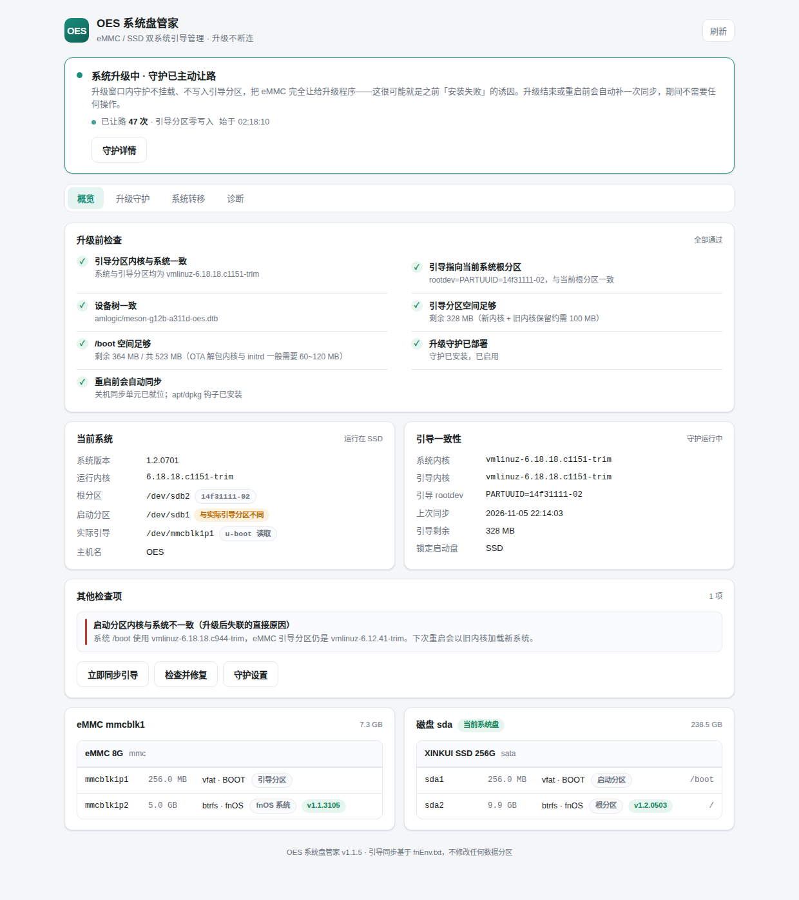
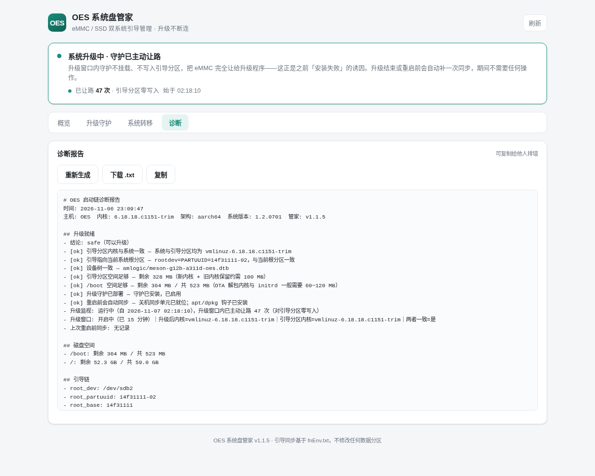
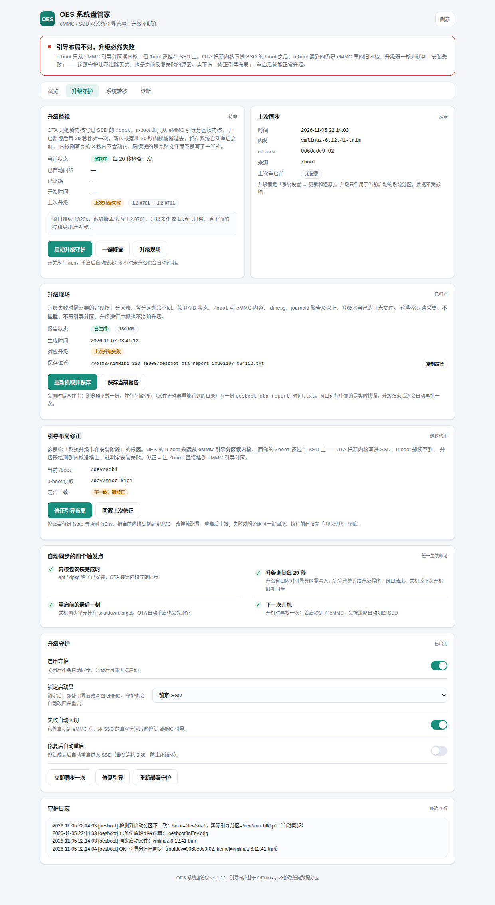
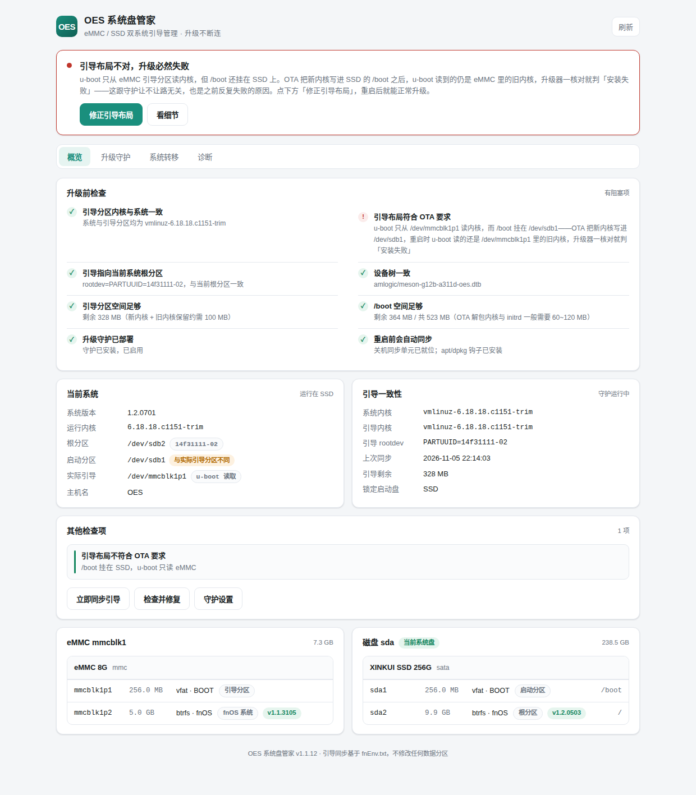
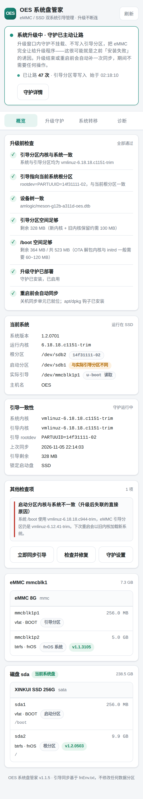
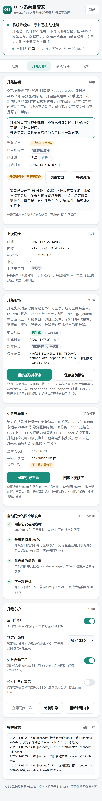
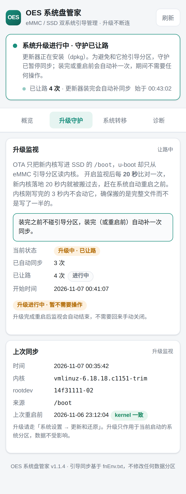
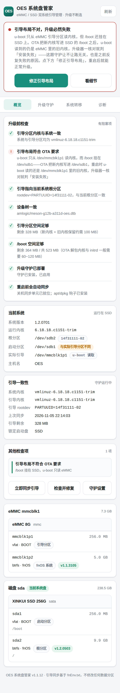

# 文档与截图

| 文件 | 内容 |
| --- | --- |
| [ARCHITECTURE.md](ARCHITECTURE.md) | 引导链、组件分层、五个触发点、状态文件路径、现场报告结构 |
| [TROUBLESHOOTING.md](TROUBLESHOOTING.md) | 按症状索引的排障手册，含诊断命令速查与回滚方式 |

## 界面截图

以下截图来自实际设备，用于 README 与 issue 中说明界面。采集自早期版本，**界面文案可能与当前版本略有差异**，判定逻辑以代码和 [ARCHITECTURE.md](ARCHITECTURE.md) 为准。

### 桌面端

| 预览 | 对应页面 |
| --- | --- |
|  | 概览 · 升级前检查与结论卡 |
|  | 诊断 · 启动链、分区、挂载与检查项 |
|  | 升级守护 · 策略、现场报告、同步日志 |
|  | 引导布局检查与修正入口 |

### 移动端

| 预览 | 对应页面 |
| --- | --- |
|  | 概览（375px） |
|  | 升级守护 |
|  | 升级中 · 已让路 |
|  | 引导布局提示 |

## 更新截图

1. 在设备上打开应用，或本地 `make preview` 后用浏览器打开对应地址；
2. 用系统截图工具保存为 PNG，尽量压缩到 500KB 以内；
3. 同名覆盖本目录下的文件，并在上表补充说明。

> 截图里可能带有设备主机名、内网 IP、序列号，提交前请检查并打码。
